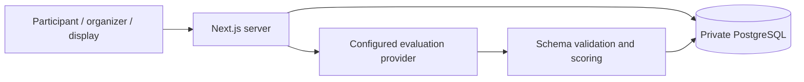

# The Great Prompt-Off

A Next.js workshop platform for schema-driven extraction challenges. Participants use organizer-issued access codes, practice with public reports, and submit against a held-out set. The repository contains synthetic demonstration fixtures, not a live event's data or configuration. This is an educational prototype, not a clinical diagnostic system.

## Current architecture

- Next.js App Router, React, TypeScript and Tailwind CSS.
- **Direct PostgreSQL** through the server-only `pg` pool. No Supabase service, SDK, public database key or Supabase authentication is required.
- Configurable classification/measurement schemas, versioned references, weighted scoring, immutable run snapshots and guarded contest activation.
- Organizer contest library, phase controls, announcements, participant management, results exports and deterministic Simulation Lab.
- Sandbox practice, counted public attempts, public-result history and one final submission; budgets, report splits, models and fields belong to each contest, not fixed README values.
- Shared provider scheduling and retries. Public submissions support an asynchronous receipt/progress path. Workers are process-local: a restart can strand pending work; see [recovery](db/README.md#attempts-and-recovery).
- Server-side model evaluation through the provider configuration in [openrouter.ts](app/lib/openrouter.ts). Deterministic mode is available without paid calls.

The `app/lib/supabase/` directory and some API `source: "supabase"` values are compatibility names for PostgreSQL-backed workflows, not a live Supabase dependency. Do not rename them piecemeal or run legacy Supabase SQL as a migration procedure.



## Local development

Use Node.js 22, npm and PostgreSQL 17 (or the supplied Docker Compose packaging).

```sh
git clone https://github.com/howardpchen/the-great-prompt-off.git
cd the-great-prompt-off
npm ci
cp .env.example .env.local
```

Configure a private, disposable development database and independent authentication secrets. Never commit real credentials or reuse production configuration. Secret-file variables refer to protected files outside the repository.

| Variable | Purpose |
| --- | --- |
| `PGHOST`, `PGPORT`, `PGDATABASE`, `PGUSER` | Server-only PostgreSQL connection; app role should be DML-only. |
| `PGPASSWORD_FILE` | Protected database password file; `DATABASE_URL` is an alternative connection configuration. |
| `PGPOOL_MAX` | Bounded pool, default 10, maximum 50. |
| `ADMIN_SECRET_FILE` | Independent organizer secret, at least 32 bytes. `ADMIN_SECRET` is the direct-value alternative, not an additional source. |
| `PARTICIPANT_SESSION_SECRET_FILE` | Independent participant signing secret, at least 32 bytes. `PARTICIPANT_SESSION_SECRET` is the direct-value alternative. No database-key fallback. |
| `APP_ORIGIN` | Exact trusted browser origin, e.g. `http://localhost:3000`; writes require matching Origin. |
| `USE_REAL_LLM` | Keep `false` for deterministic development. Real evaluation needs separately configured provider credentials. |
| `OPENROUTER_MODEL`, `OPENROUTER_CONCURRENCY` | Model fallback and process-wide scheduling; see [provider pacing](docs/provider-pacing.md). |
| `ALLOW_LOCAL_FALLBACK` | Keep `false`; explicitly enabled fallback is development-only and never a production success path. |

See [database setup](db/README.md) and [deployment/recovery](deploy/README.md) for role provisioning and secret mounts. Apply `npm run db:migrate` as the migrator, then **only for an empty synthetic database** run `SEED_DEMO=true npm run seed:demo`. The seed refuses an existing challenge; it is not a bulk import/upsert command and must not run at application startup.

```sh
npm run dev
```

Routes: `/` entry, `/challenge` participant workspace, `/admin` organizer console, `/admin/cases` report/reference management, `/admin/analytics`, `/admin/simulations`, and `/display/leaderboard`.

## Verification

```sh
npm test
npm run lint
npm run build
npm audit --omit=dev --audit-level=high
```

`npm run test:e2e` runs Playwright. Database and browser mutation tests require the specific disposable database/fixture guards documented in their scripts. Never target an actual event. CI also exercises isolated containers and backup/restore; a harness's presence is not proof of a particular release passing.

## Deployment and privacy

Supported repository packaging is Docker Compose with a private database network, loopback-only app binding, separate migration tooling, file-mounted secrets and an unprivileged/read-only application container. [deploy/README.md](deploy/README.md) documents the baseline private rehearsal, backup and rollback mechanics. Any public HTTPS reverse proxy or live-provider override is separately operated; it is not enabled by the default Compose file. Old Vercel/Supabase setup is historical, not the current deployment procedure.

- PostgreSQL stores contest definitions, reports, references, participants, reservations, runs, submissions and Sandbox history. See [architecture](PROJECT_ARCHITECTURE.md).
- Participant access is signed and account-checked. Private report/reference data and raw final outputs must remain server-side. Public practice feedback may include allowed per-field comparisons; do not describe all practice references as categorically secret.
- Reports, annotations, submissions, access codes, dumps, imports/exports and deployment configuration do not belong in this code repository. Keep them in separately protected storage.
- Report content may be sent to the configured inference provider when real evaluation is enabled; dataset permission and provider suitability must be established independently.
- Back up and restore-test before updates. Code rollback does not undo database migrations. Keep event phase, budgets, models, secrets and existing results unchanged during code-only releases.

## Documentation

- [Architecture and data flow](PROJECT_ARCHITECTURE.md)
- [Database and migrations](db/README.md)
- [Deployment and recovery](deploy/README.md)
- [Event checklist](DEMO_CHECKLIST.md) / [short rehearsal](PROJECT_DEMO_CHECKLIST.md)
- [Reports and references](REPORT_IMPORT_GUIDE.md)
- [Configurable contests](docs/configurable-contests.md), [contest library](docs/contest-library.md), [educational workflow](docs/educational-workflow.md), [Sandbox](docs/prompt-sandbox.md)
- [Simulation Lab](SIMULATION_GUIDE.md)
- [Security audit and remaining limitations](docs/security-audit-2026-11.md)

## Limitations

Login throttling is in-memory and shared per process, not a distributed abuse-control service. Participant tokens are stored in sessionStorage and remain valid up to eight hours; regenerating an access code does not revoke an issued token. Deactivating the account blocks guarded data paths. No comprehensive CSP is configured. Request limits and regression tests reduce risk, but are not a penetration-test certification. Event-specific capacity, paid-provider behavior and dataset/reference quality require separate validation.

## License

[MIT](LICENSE).
